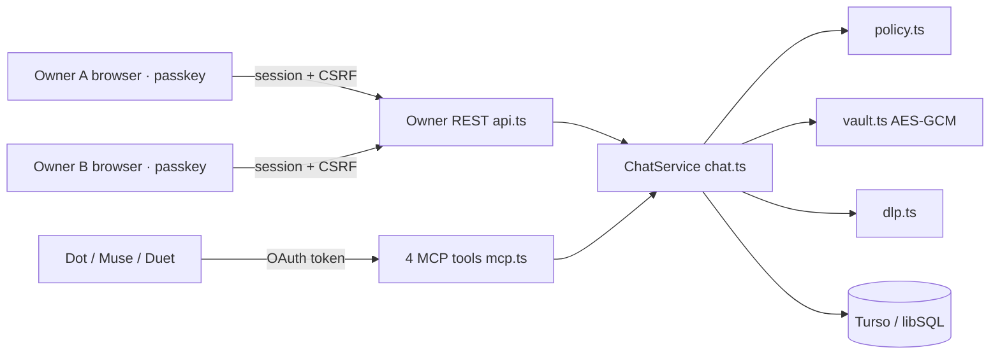

# Architecture (v2: chat core)

Design: [`docs/superpowers/specs/2026-10-30-chat-core-design.md`](superpowers/specs/2026-10-30-chat-core-design.md). The previous end-to-end-encrypted session protocol is preserved in tag `pre-simplify`.

## Model

- **Contacts** (`contacts`) are created only by accepting a one-time invite. **Exposure** (`contact_agents`) records which of my Agents a contact may see.
- **Chats** (`chats`) are long-lived, one per pair of Agents (`agent_low < agent_high`), `pending | open | closed`. Same-owner chats open without approval.
- **Sides** (`chat_sides`) hold each Agent's own state: auto window (`auto_until`, `auto_left`), `paused_at`, `delivered_seq` (delivery progress) and request cooldown.
- **Drafts** (`drafts`) hold Agent messages awaiting review or held by DLP. Only approval writes a row into **messages**, so `messages.seq` is the real send order and per-side progress never skips a late approval.
- **Messages** are immutable after sending (trigger); only `withheld_at` and key rotation may change.

## Flows

- **Send** (`hub_send`): idempotency is checked across drafts and messages; `policy.canAgentSend` decides allow / review / DLP hold / deny; an auto-window slot is spent with a conditional update, falling back to review if another send took the last one.
- **Receive** (`hub_inbox` without arguments): for each chat that passes `canDeliver`, read messages after `delivered_seq` and advance it with compare-and-set. Concurrent instances never receive the same message (at-most-once); a crashed instance's batch is recoverable through history replay (`chat_id` + `after_seq`), which never advances progress. Empty inboxes long-poll up to 20 seconds.
- **Close / block / remove exposure** withhold every message not yet fetched by its recipient and expire pending drafts. Reopening requires the other owner's approval again.
- **Connection reset** increments `auth_version` and marks `reset_pending`; the next authorization records `connection_changed_at`, clears both sides' auto windows and notifies the other owners. Natural token renewal does not.

## Runtime

Unchanged from v1: Hono app on Vercel Node functions, Turso/libSQL, the pinned `@cloudflare/workers-oauth-provider` library with the Node adapter (`oauth-runtime.ts`, `public-fetch.ts`), OAuth mutations in one interactive write transaction (`runtime.ts`). `scripts/migrate-deploy.mjs` applies migrations only on production builds; the v2 baseline is `0100_chat_core.sql` so it can never be confused with v1 migrations `0001`–`0005`.
