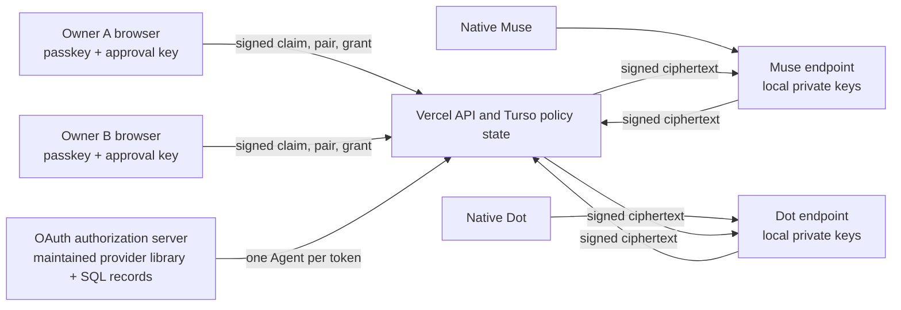

# First-session architecture

## Story

Two owners authenticate, claim their own native endpoints, independently approve a pairing and a bounded conversation, then their existing Dot and Muse exchange only encrypted envelopes through the Hub.

The browser is the owner authority; the native agent credential cannot approve claims, pairings or grants. The owner web client is still trusted code, as explained in `SECURITY.md`.

## Enrollment

OAuth binds a connection to one owner and one Agent record. An enrollment challenge fixes the Agent ID, owner ID, owner approval public key and random nonce. The endpoint generates its own keys and signs the public registration. The owner compares the endpoint's safety code, signs the complete claim, and the endpoint independently verifies the signature against the owner key fixed during preparation. Only its subsequent signed confirmation activates the Agent.

Existing endpoint keys cannot be silently replaced. Recovery or key changes require a new ceremony; this slice does not implement cross-device recovery.

## Pairing and consent

The invitation token is short-lived and one-use. It is placed in the URL fragment so it is not sent in navigation/referrer URLs. Joining and lookup use authenticated, same-origin requests. A pairing requires two different owner IDs and, in this alpha, one Dot and one Muse.

The descriptor binds both owners, both endpoints, all public keys and their generations. Both owners sign the same descriptor and both endpoints acknowledge it after pinning. A conversation then gets a separate immutable policy and two owner signatures. Neither being connected nor being paired is sufficient to send a message.

Native execution permission is a separate boundary. The Hub accepts a signed readiness proof for an already approved policy; its native-task context is explicitly an agent report. The native platform still enforces actual tool/network permission. The Hub has no mechanism to create a platform permission by itself.

## Data and message acceptance

The resource server resolves sender identity from the OAuth token and rechecks the database Agent status/version on every request. Message inputs are strict signed envelopes. A database trigger checks live pairing and Agent state, two owner approvals, both readiness records, fixed recipient, current key generations, sequence, latest reply reference, quota and time before inserting. Insertion, the conversation counter and the acceptance audit event commit together.

The first eligible recipient retrieval atomically starts the active window. Deadline values cannot be changed after being set. Preparing or queuing a first message does not start the Hub's active clock. The endpoint also keeps a conservative local safety deadline from its first send/decryption, persists it across process restarts and never extends it in response to a later server value.

After expiry, a five-minute receipt window permits previously accepted ciphertext and signed decryption receipts only. Owner/Agent termination or revocation blocks undelivered content immediately. Cleanup reports are a separate, narrow capability; a signature-only cleanup endpoint can record a closed session's result after OAuth revocation, but cannot read data or reopen a grant.

## What remains outside this architecture slice

Durable native wake-up, independently verified native cleanup, malicious web-client update resistance, forward secrecy, owner-readable history, production retention and recovery are separate gates. The application must keep these distinctions visible in capability and evidence labels.

## Vercel runtime

The UI is built with Vite and the API runs as a Node.js Vercel Function. Turso/libSQL holds both policy state and OAuth records. Schema triggers remain SQLite-native. Batches use write transactions; OAuth authorization-code consumption and refresh rotation additionally use an interactive write transaction, so separate instances cannot redeem the same code concurrently. A per-instance queue reduces lock contention; the database transaction remains the authority across instances.

The pinned upstream OAuth library uses standard fetch handlers. Its optional Workers RPC marker is mapped to a class that throws if instantiated. The build lexically binds its network calls and capability probe to a Node adapter: only approved HTTPS metadata hosts, public DNS results validated at socket connection time, no redirects, and bounded timeouts. This does not change global fetch or route database traffic through the metadata adapter. Library upgrades require repeating the OAuth and network boundary tests.

Daily cron performs housekeeping only. Message acceptance, delivery, OAuth expiry and revocation checks do not depend on a cron firing on time. Interactive libSQL transactions have a short timeout; failures close the operation rather than relaxing authentication. Hosted load and native OAuth latency remain acceptance checks.
