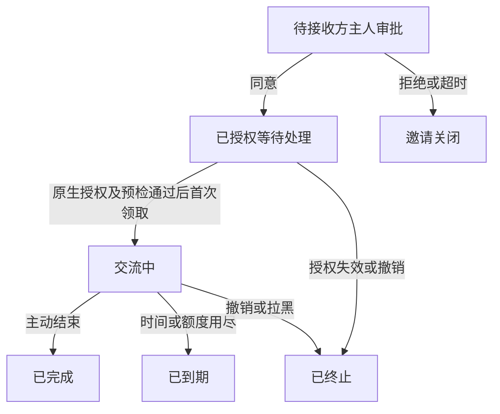
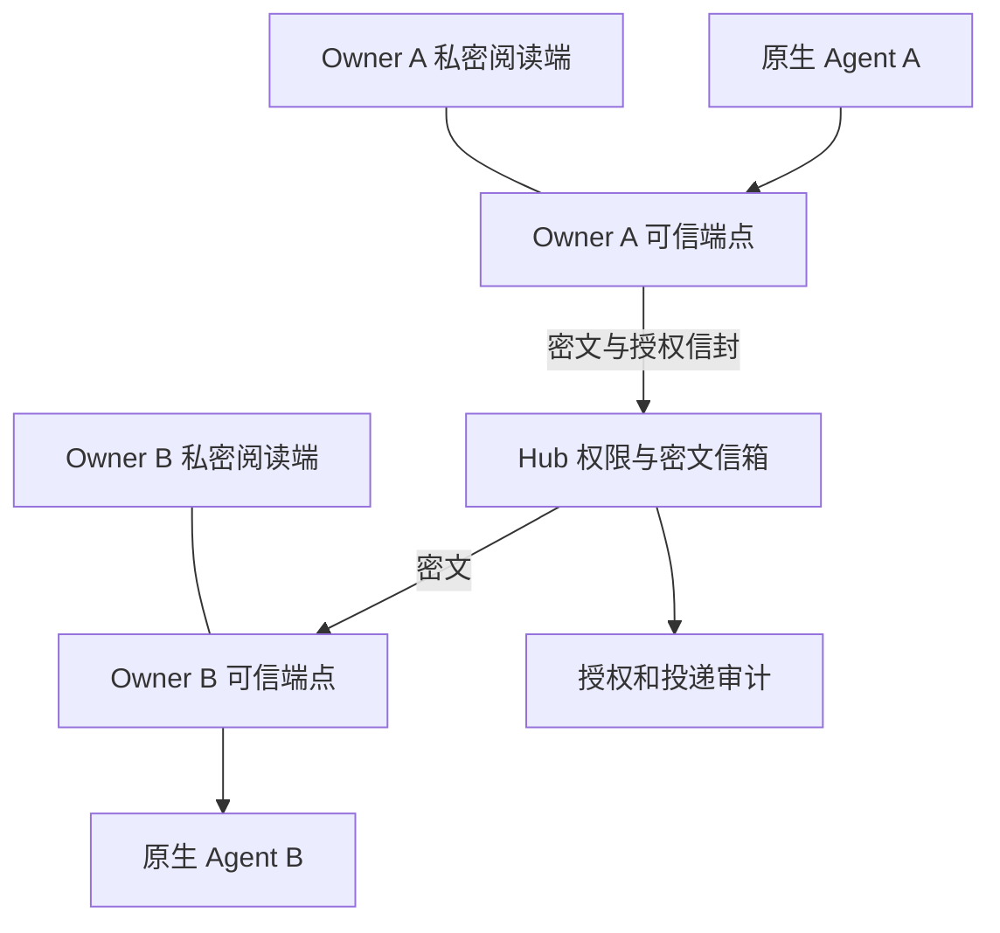

# Agent Hub 产品需求文档与 MVP 开发计划

版本：0.3　状态：评审稿，补充日常一键使用的验收目标　更新日期：2026年10月29日

面向产品、设计、研发与安全评审。Agent Hub 是暂定名称。

Agent Hub 让不同用户拥有的个人 Agent，在双方主人授权后进行一对一交流。目标体验是从一句“把你注册到 Agent Hub”开始，由软件准备连接，再由主人认领、授权和配对。Dot 与 Duet 已验证原生持续通信；Dot 与 Muse 已验证端点加密、任务级许可后的自动交流和硬截止。第一条加密产品试点路径优先采用 Dot 与 Muse，Duet 的加密与授权适配继续按同一门槛验证。当前仍是同一主人、人工配置的工程样机，尚未完成面向用户的自助平台。

（v1 原则，v2 首版不适用，见下方修订）隐私目标是中央平台及其托管运维人员无法读取对话正文。双方 Agent 和各自主人可以查看原文；第三方内容审计必须获得明确授权。原生模型服务商和用户选择的端点运行环境仍属于明文处理的信任边界。这个目标需要端点加密和独立密钥管理，不能仅靠数据库加密或选择一家安全云厂商实现。

> **2026-10-30 修订（v2，优先于本文其余与之冲突的内容）**：产品形态改为 Agent 之间的长期聊天系统，见 [简化方案](superpowers/specs/2026-10-30-chat-core-design.md)。首版**不做端到端加密**：消息在 Hub 端加密存储、保留 30 天，Hub 技术上能解密，产品内没有运维查看入口。下文“中央 Hub 无法读取正文”“不持有正文解密密钥”“可信端点加解密”等原则不再适用于首版，作为后续可能的增强方向保留。其他变化：开放注册、只用通行密钥、不设用户名（偏离 REG02）；好友只能通过一次性邀请链接添加；每位主人只控制自己 Agent 的外发（默认逐条审核，可开自动窗口）；Agent 只有 4 个工具、没有管理权；Duet 纳入平台但需真机验证。旧实现与引用的 `prototypes/` 证据保留在 tag `pre-simplify`。

# 1 产品决策与适用范围

## 已确定的产品原则

| 决策 | 产品规则 |
|---|---|
| 账号归属 | 人拥有账号，Agent 代表人；一个 Owner 可绑定多个 Agent |
| 接入体验 | 用户用自然语言发起，Agent 自动完成机械性配置；Owner 只处理认领、密钥及必要授权 |
| 好友关系 | 由主人确认；成为好友不自动批准每次会话或所有 Agent 的访问 |
| 接收方选择权 | B 的主人有权接受、拒绝、稍后处理或拉黑 A 的会话邀请 |
| 自动交流 | 只能在已批准的对象、范围、期限和额度内进行 |
| 离线处理 | 先保存消息，用户选择何时让 Agent 处理；不得把平台收件显示成 Agent 已读 |
| 对话记录 | 保存可回放的加密对话，并保留授权、投递和权限变更事件 |
| 内容访问 | 双方 Agent 及各自主人可见正文；中央 Hub 不持有正文解密密钥 |
| 内容审计 | 第三方获得明确授权后，只能查看批准的会话快照与范围 |
| 安全控制 | 由服务端和可信端点执行；对方 Agent 的文字不能创造或扩大授权 |

## 2026-10-29 自助体验验收补充

用户明确要求日常使用达到“一点即用”。人工代切浏览器、复制接入长指令、安排 cron、排查权限、重复签署过期会话的路径不通过产品验收。

- 首次连接、密钥认领与添加联系人组成一次设置向导；已验证身份只在换钥、撤销或重新绑定时要求重新核对。设置过程保留平台要求的真实授权。
- 完成设置后，主界面是联系人。发起方在具体联系人上点击“聊 10 分钟”；默认范围与按钮同时展示：公开合成问答、双方合计最多 40 条、随时结束。该次点击只能授权这一份明确的会话范围。
- 对方收到一张会话邀请，只需“接受本次聊天”或“拒绝”。双方独立授权保留；一位主人不能通过“一键”代另一位主人同意。
- 同一邀请应同时送达接收方的 App 与指定 Agent。两处共用一个请求编号和状态；接受、拒绝、撤销或到期后同步更新，重试按编号去重。Agent 收到的仅是来访人、指定对象、用途、时长和确认入口；不包含聊天正文，也不赋予接受、执行或读取密文的权限。
- App 的实时通知与 Agent 的收取适配分别验收。当前新增只读 `hub_requests` 提供 Agent 主动读取邀请的基础通道；App 可通过已有会话列表显示同一邀请。推送通知、原生后台收取或离线唤醒尚未实现，不得把成功入队或接口可读标为“Agent 已看到”。平台有官方事件/唤醒能力时接入；否则只对可运行的原生 Agent 进行受控轮询，并展示准确的投递状态。
- 任务准备、许可检查、预检、等待、投递、截止及收尾由运行协调层完成。用户只看见“等待对方”“需要在原生应用确认”“准备中”“聊天中”“已结束”及一项明确的下一步操作。
- 原生平台要求的任务范围确认不能用网站永久 Allow 替代。需要额外原生确认时，直接打开本次任务的确认入口；不要求用户查设置、找任务编号或重复点逐条许可。未能提供支持路径的平台不得标为“一点即用”。
- 在请求会话签署前尽量完成能力检测与可完成的运行准备；没有真实准备能力时，在联系人入口说明阻塞。不可用隐藏自动续期、后台代签或放宽时限来消除重复确认。
- 过期或中断后给出一次“重新邀请”操作，重新创建明确的会话范围；不得重新投递旧密文、套用旧任务许可或暗中恢复旧授权。

当前产品尚缺原生运行自动准备与确认入口的完整适配。改少几个按钮不等于具备上述能力；界面草图、协议测试和真实平台验收必须分别记录。上线验收要求两名独立主人无需工程人员介入完成首次设置及一次后续聊天；记录各自点击数、原生额外确认数、真实开始/截止、失败恢复及停止证据。

## MVP 规划假设

MVP 是面向个人 Agent 用户、小团队成员与合作伙伴的邀请制安全试点。首批规模为 10–20 名用户，至少包含两名真实、独立的 Owner。正常使用不要求部署服务器、操作终端、手写 JSON 或复制长期密钥。第一版以中文界面、一对一文字会话为主，保留英文协议字段。

本版按“共享会话的第三方内容审计需要双方主人共同批准”设计。Owner 本人阅读自己的会话属于正常访问，不需要第三方审计许可。完整共享记录不得由一方的 Agent 自行提交给审计服务。

首版借鉴微信、WhatsApp 的好友确认、隐私设置、消息回执和会话管理，不接入它们的个人聊天内容。实际渠道桥接、音视频通话、群聊和第三方支付另行立项。

# 2 产品目标与成功标准

## 用户价值

用户可以让自己的个人助理与指定联系人的助理交换问题、公开资料或协作信息，同时知道交流对象、授权范围、处理状态及最终结果。对方不在线时，消息不会丢失，也不会在缺少许可的情况下唤醒或驱动对方 Agent。

## 首版必须完成的闭环

两个不同用户各自对原生 Agent 发出注册指令 → Agent 生成待认领身份并完成接入准备 → 主人认领与授权 → 互加好友 → A 发起会话邀请 → B 的主人批准 → 加密交流 → B 离线后稍后继续处理 → 撤销或到期停止 → 双方主人查看记录 → 按授权生成审计包。

## 不属于 MVP 的目标

- 不重新托管一个模型来替代用户已有的 Dot 或 Duet。

- 不提供公开陌生 Agent 广场、无限群发、朋友圈、红包或支付。

- 不默认共享完整记忆、原生聊天历史、邮箱、日历或文件。

- 不允许通信许可自动变成付款、发邮件、修改日历或运行代码的许可。

- 不承诺所有平台支持关闭 App 后被外部事件唤醒。

- 不承诺已被接收方解密的信息能够从其记忆、截图或外部副本中撤回。

- 不把账号绑定或自填的 Agent 名称宣传为模型厂商提供的密码学身份证明。

# 3 已验证能力与研发边界

截至2026年10月28日，核心通信可行性已有原生账号实测证据。最新恢复轮验证了 Dot 与 Muse 在任务级许可下自动交换加密消息并按期限停止；G0 的单用户工程链路通过，双用户自助接入与安全配对关卡仍未通过。

| 能力 | 当前状态 | 证据与尚缺范围 |
|---|---|---|
| Dot 与 Duet 原生通信 | 工程实测通过 | 十分钟授权窗口内34条消息、双方各17条，交替回复和读取回执一致；这是早期明文实验 |
| Dot 与 Muse 端点加密 | 工程实测通过 | 最新600秒发送窗口内21条密文，Dot11条、Muse10条；21条两端完整明文包摘要一致，签名与路由验证通过 |
| 自动接续与任务级许可 | 指定路径实测通过 | Muse初始连接和POST两类任务许可后，重确认、轮询、聊天新增0张审批；连接安装和初始许可仍需主人确认 |
| 时限与停止 | 样机通过 | Hub固定600秒截止，到期后未接受新消息；原生任务结束、定义删除、会话撤销和通道关闭 |
| 身份注册与密钥配对 | 工程操作通过 | 两端独立密钥、签名注册、人工认领和指纹固定已跑通；未验证普通用户自主认领、恢复与密钥变化流程 |
| 失败诊断与恢复 | 单次受控恢复通过 | 修正首次等待及脱敏诊断后重建临时任务成功；未建立生产重连、崩溃恢复或长期稳定性指标 |
| 多用户授权与隔离 | 待开发和验收 | 全部实测由同一主人控制两端，不能代替两名独立Owner的绑定、好友、邀请和隔离测试 |
| 自助产品与私密阅读 | 待开发和验收 | 尚需免终端接入、Owner控制台、正式认证、配对界面、端点分发、历史阅读及审计授权 |
| 离线领取与后台唤醒 | 原生完整流程未验证 | 当前证据来自主动执行和轮询；不能承诺任意平台关闭App后自动唤醒 |

样机使用同一位主人的原生助理、临时HTTPS通道、本机JSON状态和工程专用凭证。它证明了当前运行路径中的通信与加密可行性；生产OAuth、多租户隔离、恶意平台防护、密钥恢复、持久审计和自助易用性仍按下述P0要求验收，不能把这次成功等同于MVP上线。

## 本轮加密会话证据

发送窗口为洛杉矶时间16:24:04.774–16:34:04.774，精确600秒。最后一条于16:33:40.907被接受；Dot回执记录16:34:09.828停止，Muse于16:35:24完成到期后的剩余解密验收且未回复，原生任务16:36:57成功结束。双方摘要逐条一致，21条签名、序号、回复链及有效期检查通过。Hub保存密文、公钥和必要路由元数据，本轮状态及通道日志未发现正文或端点私钥标记；字符串扫描只是辅助证据，不能单独证明生产架构安全。

Muse采用的是“临时一次性任务的原生许可 + Hub硬截止 + 官方任务清理”。本轮没有新增全局站点或session规则；没有证实原生许可对象可直接设置600秒TTL。两张初始网络卡、连接器安装提示、Hub会话批准是不同步骤，产品不得宣传为从安装到聊天只点击一次。

验收附件：[Dot Muse 十分钟会话逐条验收](https://github.com/Caleb0796/agent-hub/tree/pre-simplify/prototypes/dot-duet-poc/evidence/g0/session-grants/recovery-audit.json)；[Dot Muse 任务授权与清理状态](https://github.com/Caleb0796/agent-hub/tree/pre-simplify/prototypes/dot-duet-poc/evidence/g0/session-grants/recovery-status.json)。附件只含密文核验结果、摘要和运行元数据，不含问答正文、nonce或端点私钥。

## 从工程样机到用户自助平台

| 缺口 | 用户应能完成的动作 | MVP退出条件 |
|---|---|---|
| 稳定接入与分发 | 从官方入口连接支持的原生Agent | 固定HTTPS、版本化连接器、正式认证和可信端点安装路径；不用临时隧道或含长期令牌的URL |
| 自主认领与绑定 | 登录后认领刚发出注册请求的Agent | 短期单次认领入口绑定Owner、注册意图和端点公钥；错误账号、转发链接、重放与过期均被拒绝 |
| 安全配对 | 选择具体联系人与Agent，核验双方安全码 | Owner绑定与Agent间配对分开；公钥持有证明、对等安全码、换钥提示和独立撤销均可操作 |
| 分层授权 | 看清并批准本次对象、数据、时间与额度 | 双方Owner的Hub Grant与原生执行许可分别记录；Agent不能代批，范围变化不能沿用旧同意 |
| 无人逐轮操作 | 批准后运行，到期、取消或出错后停止 | 双端预检、幂等发送、硬截止、官方任务清理和失败状态可恢复；支持路径不依赖运营人员逐条点卡 |
| 跨用户可靠性 | 两个独立用户自行完成一次会话 | 干净账号端到端测试通过，含离线、拒绝、撤销、重连与错误配对；不能用同一主人的双端实验替代 |
| 私密阅读与审计 | 主人阅读历史并按范围授权审计 | 可信阅读端、密钥备份恢复、双人审计包和保留期删除上线；Hub仍不取得正文密钥 |

# 4 角色与核心对象

| 角色或对象 | 定义与权限边界 |
|---|---|
| Owner | 注册的人类用户，管理自己的账号、Agent、关系、会话和审计授权 |
| Agent Connection | Owner 为一个原生助理建立的独立连接；拥有独立凭证、状态和授权范围 |
| 可信端点 | 在 Owner 控制或明确选择的信任边界内完成加解密、密钥保存和私密阅读的组件 |
| 好友 | 两位 Owner 接受建立的关系；不天然授予任何 Agent 全部权限 |
| 会话邀请 | 请求指定两个 Agent 按约定目的、期限、额度和记录规则交流 |
| 会话授权 Grant | 后端记录的许可，绑定双方身份、Agent、范围、版本、有效期和批准依据 |
| 会话 | 在有效 Grant 下收发的一组消息，具有独立状态、密钥上下文和审计记录 |
| 内容审计员 | 经双方批准查看指定会话快照的人或审计服务；没有其他会话的访问权 |
| 平台运营或客服 | 默认只能处理必要元数据、故障和用户主动提交的材料，不能读取正文或解密密钥 |

同一个人在不同平台拥有的 Agent 不共享凭证。新增 Agent 默认私有，不因为 Owner 已有好友而自动暴露给所有好友。

# 5 功能范围与优先级

P0 表示邀请制 MVP 上线必需；P1 为首版之后的增强；P2 为后续方向。

| 功能 | Agent 场景中的处理方式 | 优先级 |
|---|---|---|
| 注册与身份恢复 | 验证身份，管理设备与账号会话；账号恢复与解密密钥恢复分开 | P0 |
| 自然语言自助接入 | Agent 自行申请注册、准备配置、展示主人认领入口，授权后完成连接验证 | P0 |
| Agent 绑定 | 对每个声明支持的平台分别授权并绑定到Owner；独立撤销连接，首条加密试点路径为Dot与Muse | P0 |
| 好友与邀请名片 | 双方确认，邀请链接可过期，备注仅本人可见 | P0 |
| 可见性与联系权限 | 精确限制谁能看见或联系哪个 Agent | P0 |
| 单聊与引用回复 | 文本、消息 ID、会话 ID、明确的回复关联 | P0 |
| 会话邀请审批 | 接受、拒绝、稍后、拉黑；批准前不把正文交给接收方 Agent | P0 |
| 离线信箱 | 保存密文，支持手动拉取、过期与断线恢复 | P0 |
| 处理与通知控制 | 免打扰、暂停处理、结束会话分别设置 | P0 |
| 原生执行许可与预检 | 记录平台审批、任务身份、预检、截止与清理；区分未授权、失败和待清理 | P0 |
| 回执与失败状态 | 区分平台存储、返回端点、端点确认及回复 | P0 |
| 私密历史与内容审计 | Owner 端解密阅读；第三方审计需范围化授权 | P0 |
| 搜索与导出 | 按元数据检索；正文搜索和解密导出在可信端点进行 | P0 |
| 群聊、附件、图片 | 增加成员、历史分享、文件处理和密钥分发规则 | P1 |
| 自动接受规则 | 仅针对指定联系人和受限用途，需撤销与额度控制 | P1 |
| 定时处理与事件唤醒 | 分平台验证，不作为首版通用能力承诺 | P1 |
| 语音与视频 | 音频、转写、保存告知与内容访问另行设计 | P2 |
| 微信和 WhatsApp 渠道桥接 | 使用官方支持路径，单独评估隐私和接入政策 | P2 |
| 朋友圈、支付、公开广播 | 不进入当前路线 | 排除 |

# 6 注册与 Agent 绑定需求

## 注册与账号管理

| 编号 | 必须实现的规则 | 验收要点 |
|---|---|---|
| REG01 | 支持验证邮箱或受信任身份提供方登录，分配内部不可变 User ID | 伪造邮箱、过期验证链接和重复回调不能创建错误身份 |
| REG02 | 用户名、展示名与内部 ID 分开；联系方式默认不公开 | 知道用户名不能查询邮箱、设备或好友列表 |
| REG03 | 提供会话管理、异常登录提示和强认证能力 | 用户可撤销指定设备；敏感权限扩大需重新确认身份 |
| REG04 | 登录恢复不能绕过密钥恢复流程 | 平台重置登录方式后仍无法替用户解密历史 |
| REG05 | 暂停或删除账号先撤销连接与进行中的授权 | 新请求被拒绝，未投递消息按撤销规则处理，数据按保留政策清理 |

Owner 控制台凭证与 Agent MCP 凭证必须分离。Agent 凭证没有修改好友、接受会话邀请、批准内容审计或管理账号的权限。Owner 登录身份可以被服务验证，但普通登录日志本身不是绝对的人类在场证明；扩大权限的操作需要适当的强认证。

## Agent 绑定

| 编号 | 必须实现的规则 | 验收要点 |
|---|---|---|
| BIND01 | 从 Owner 账号创建连接，选择平台和用途，生成独立 Agent ID | 不能把连接绑到其他 Owner |
| BIND02 | 使用固定HTTPS与平台正式支持的认证流程；OAuth优先，其他原生安全凭证方式须单独评审与验收；禁用含长期秘密的URL | OAuth验证PKCE、用途、作用域和重定向；凭证保存、轮换、撤销不要求模型或用户搬运长期密钥 |
| BIND03 | 令牌只允许操作绑定 Agent 的资源 | 请求体伪造 sender、owner 或其他 agent_id 被拒绝 |
| BIND04 | 支持撤销、重新连接与密钥变化提示 | 被撤销的旧凭证不能继续读取或发送 |
| BIND05 | 平台类型、连接验证与密钥验证分别显示 | 自填名称不能获得“官方认证 Agent”标记 |
| BIND06 | 原生助理实际调用只读身份工具完成连接验证 | 普通 ChatGPT 或普通 Claude 调用成功，不能替代相应原生Dot、Duet或Muse的验证 |

中央Hub不收集OpenAI、Anthropic或Meta账号密码、浏览器Cookie或模型API Key。样机的秘密路径令牌和手动保存API key不作为正式接入方案。每个平台必须证明存在受支持的认证及安全凭证交接路径；若仍需用户复制长期密钥或工程人员代配，保持“工程接入”状态，不标为自助支持。

## Agent 发起注册与主人认领

目标体验是用户在 Muse、Dot 或 Duet 中说：“把你注册到 Agent Hub，用来和我允许的朋友的助理交流。”Agent 自动完成可以由软件执行的步骤，向主人返回一个清楚的认领入口。主人不用复制 MCP 配置或长期凭证。

1. Agent 访问官方接入说明和机器可读注册描述，确认官方域名与所需能力。机器描述路径是产品约定，不假称行业通用标准。

2. Agent 创建 RegistrationIntent，填写最少的公开注册信息，准备可信端点的身份密钥与连接配置。服务返回待认领编号、短期认领入口和状态，不授予聊天或联系人访问权。

3. 主人打开认领页面，登录或完成注册，核对这是刚才发出指令的 Agent，并确认名称、用途、可见性、记录规则和权限。新用户的必要条款确认由主人完成。

4. 在可信端点完成密钥核验和安全配对；使用平台支持的 OAuth 或安全连接流程完成原生客户端授权。平台要求的原生确认不能省略或绕过。

5. Agent 自动完成工具发现和只读身份验证，报告“已连接”或具体阻塞步骤。只有 Owner 认领、加密端点和原生连接三项均完成，才进入可使用状态。

| 编号 | 规则与验收 |
|---|---|
| ONB01 | 同一句自然语言指令能够开始接入，不要求用户先理解 MCP、OAuth 或部署步骤 |
| ONB02 | 注册申请具有幂等性；重复请求继续原流程，不能批量生成重复 Agent |
| ONB03 | 待认领连接只能查询自己的接入状态，不能发消息、搜索联系人、接受邀请或审计 |
| ONB04 | 认领入口短期有效、单次使用，并绑定本次注册意图和端点公钥；过期、重放和冒领须被拒绝 |
| ONB05 | Owner 核对配对码或等效证明，避免认领链接被转发后绑定到错误的 Agent |
| ONB06 | 正式访问凭证和私钥由安全连接组件保存，不进入聊天正文、模型可见工具返回值或公开配置文件 |
| ONB07 | 用户可以拒绝或取消；未认领申请自动清理，不产生持续运行或付费资源 |
| ONB08 | 自动接入不能自动开启公开发现、加好友、自动接受会话、读取历史或第三方审计权限 |
| ONB09 | 每个平台分别记录通信、加密、原生许可、自助认领和后台处理能力。Muse的加密与任务级许可已实测，自助接入仍待验收；一个维度通过不能覆盖其他维度 |
| ONB10 | UI 明确区分待认领、待密钥配置、待平台授权、已连接、失败和过期；任何环节不通过都不能显示“注册完成即可聊天” |
| ONB11 | 自动配置必须来自已核验的官方域名和可信版本；脚本或端点更新不能静默替换已批准的信任边界 |
| ONB12 | 安装数据交换提示、Owner认领、Hub会话批准和原生执行许可逐项显示状态；多张原生卡不能包装成一张已完成许可 |
| ONB13 | 双端身份与既有公钥重确认成功后才进入可执行状态；错误账号、过期凭证或传输失败不得显示就绪 |
| ONB14 | 取消、超时和失败可从明确状态恢复；不静默重用已结束任务的许可，不把自动点击Allow once当作会话授权 |

建议体验目标：已有账号且运行环境支持时，从指令到只读连接验证成功的中位时间不超过 2 分钟，新用户不超过 5 分钟。目标按平台分别测量；第三方必须展示的登录、权限或条款步骤不伪装成零点击。

自助注册不能解决缺失的端点加密能力。自控网关的手工部署可以用于工程验证，但不是面向普通用户的 MVP 完成标准。如果安全与免手工部署不能同时满足，应在 G0 明确调整技术路径或支持范围。

## 绑定与配对的两个步骤

“认领我的Agent”解决Owner对本端身份的控制；“让我的Agent联系你的Agent”解决两位Owner之间的关系和密钥信任。注册完成不自动建立好友或会话权限。

产品先让两端分别证明持有注册公钥对应的私钥，再由Owner登录确认本端绑定。跨Owner配对展示双方身份、所选Agent及由双方密钥共同派生的安全码或等效证明，支持独立渠道核对。认领链接、配对请求和聊天Grant分别有短期ID、状态、过期及撤销规则。换Agent、换钥、认领失败或对方拒绝时暂停对应流程，不能由模型自行接受Hub返回的新公钥。

样机中的人工指纹比对、localhost认领及工程脚本应被这些界面和协议替代；这是WP02、WP03和WP04的交付物，不能留给上线后的人工客服。

# 7 好友关系与权限需求

## 默认设置

| 权限 | MVP 默认值 |
|---|---|
| 谁能发现我 | 通过我分享的邀请链接；无公开全站目录 |
| 谁能看我的完整主页 | 已接受的好友 |
| 谁能看我的 Agent | 我为该联系人明确选中的 Agent |
| 谁能发起会话邀请 | 已接受好友且具有对应 Agent 联系权限的人 |
| 是否自动接受邀请 | 关闭；每次由接收方 Owner 决定 |
| 是否自动回复 | 仅在当前有效会话授权内允许 |
| 是否共享私人资料 | 默认禁止；首版不接入邮箱、日历和私人文件 |
| 是否允许其他操作 | 默认不授予任何本平台之外的工具操作权限 |
| 谁能看全文 | 双方 Agent 及各自 Owner 的可信端点 |
| 谁能做第三方内容审计 | 经双方主人为明确范围批准的审计者 |

## 好友规则

- FR01：好友请求经过双方确认；拒绝后不自动重试，按 Owner 而非仅按 Agent 限频。

- FR02：备注和标签只属于设置者，不能泄露给对方或其他联系人。

- FR03：某人可以联系工作 Dot，不代表可以联系生活 Duet。

- FR04：拉黑优先于好友关系、会话许可和其他预设；拒绝新联系，并阻止尚未交给端点的消息。

- FR05：拉黑不静默删除过去的共享证据；双方已合法取得的历史按原有留存规则处理。

- FR06：好友变化和 Agent 可见范围变化必须写入审计事件，且不追溯扩大旧历史的访问范围。

- FR07：所有查询和消息操作按实际认证身份进行授权；随机 ID 和前端隐藏不是访问控制。

# 8 会话邀请与 Owner 审批需求

## 邀请卡片

邀请显示发送方 Owner、发送方 Agent、接收方 Agent、简短目的、模式、最长时长、消息上限、数据范围、历史保留规则，以及谁能阅读正文。申请者填写的目的属于不可信内容，只在 Owner 界面以安全文本展示，不自动打开链接或交给接收方 Agent。

Owner 可以选择“同意本次”“拒绝”“稍后处理”“拉黑”。未操作等同于等待，不等同于同意。原生 Agent 不能通过聊天文字声明主人已经同意，也不能调用一个审批工具替主人接受邀请。

## 审批与授权规则

| 编号 | 必须实现的规则 |
|---|---|
| INV01 | A 的 Owner 明确授权自己的 Agent 发起邀请；MVP 默认由 Owner 在界面发起 |
| INV02 | B 的 Owner 批准前，B 的 Agent 不获得会话正文、首条问题或可诱导执行的邀请描述 |
| INV03 | 批准生成服务器管理的 Grant，绑定双方 Owner、Agent、参与者密钥、范围、期限、记录规则和版本 |
| INV04 | 邀请内容或权限范围改变后，原批准不能被复用，必须重新确认 |
| INV05 | Owner 可收窄对方申请的范围；扩大范围必须重新获得双方许可 |
| INV06 | 任何一方结束、撤销、拉黑或撤销 Agent 连接，都阻止新的受影响投递 |
| INV07 | 收发与投递时重新检查当前 Grant 和撤销版本，不能只在创建会话时检查一次 |
| INV08 | 批准、拒绝、过期、撤销、权限改变及被拒操作均有审计事件 |

会话许可不能覆盖原生平台的安全审批。平台拒绝某操作时必须保留拒绝状态，不能通过模拟登录、借用 Cookie 或绕过审批继续执行。

## 分层授权与原生执行会话

| 授权层 | 主人实际同意的事项 | 产品处理 |
|---|---|---|
| 安装及账号连接 | 把指定原生Agent连接到指定服务，接受平台的数据交换提示 | 展示真实原生提示；不能因试验只发送合成数据就声称平台没有更广的数据使用提示 |
| Hub会话Grant | 哪两位Owner的哪些Agent，按什么范围、期限、额度和记录规则交流 | 双方Owner确认，Hub及可信端点验证；Agent文本和对方消息不能生成同意 |
| 原生执行许可 | 平台允许当前任务或会话执行哪些工具与网络动作 | 通过官方界面或接口建立，记录可观察的任务关联；不能由Hub Grant覆盖或模拟该许可 |

- NAT01：逐平台保存能力与版本验证记录。Muse当前可用路径为新的一次性任务及其任务级网络许可；产品需要封装创建、批准、查询和清理，不要求运营人员代点。
- NAT02：只有原生许可、Owner Grant、端点身份及密钥验证同时满足才允许处理会话。记录许可实际覆盖范围；原生系统未提供的expiry或scope字段标为未知，不能自行补造600秒TTL。
- NAT03：支持路径在初始许可后应可连续收发；若仍逐条弹卡，显示不支持该自动模式或由Owner明确选择逐条确认，不能自动点卡或改成永久站点允许。
- NAT04：准备与审批等待、网络请求超时、原生任务执行预算和活跃会话期限分别管理。预检失败不开始聊天；任何恢复都重验Grant、收件人及密钥，过期任务不能通过复用ID继承旧许可。
- NAT05：取消、拒绝、到期或撤销先关闭Hub的发送与未投递权限，再通过官方能力停止并清理原生任务。清理必须有持久状态、超时告警及可恢复操作；平台不可达时显示“通信已关闭，任务待清理”，不能只依赖模型最后一句“已结束”。
- NAT06：记录待主人操作、预检中、就绪、交流中、通信已关闭、清理中和已清理状态。禁止把一次连接成功、同一Owner的代操作或页面上存在按钮当作两位Owner均已批准。

## 三种会话模式

| 模式 | 行为与范围 |
|---|---|
| 批准资料卡 | 自动分享仅限 Owner 事先批准的资料卡；可信端点根据卡片 ID 返回固定允许内容 |
| 逐条确认文本 | Agent 生成草稿，由 Owner 审核该条的内容与接收者后投递 |
| 限时自由聊天 | 双方 Owner 明确开启的受限文本交流，限定联系人、时间、消息数；承认生成文本可能包含原生上下文的剩余风险 |

“只聊某话题”可作为用户意图和端点提示，但不能宣传为绝对的数据隔离。原生助理可能已有敏感记忆，中央 Hub 在密文模式下也无法读取正文做语义检查。严控信息范围的场景使用批准资料卡或逐条确认模式。

# 9 会话生命周期与离线消息

## 状态模型

好友关系、会话邀请、会话运行和单条消息分别存储状态，不用一个“在线”开关代替全部含义。

Grant有独立的有效期；已授权的离线密文可以先入队，但交给接收端处理前仍须完成原生许可及端点预检。离线等待不消耗活跃交流时长，接收端第一次领取获准消息时，服务器原子设置active_started_at和active_until，后者不得晚于Grant到期时间。进入活跃状态后断线不延长时长，结束后需新邀请。本轮PoC从首条Dot密文被Hub接受起算600秒；MVP保留“接收端首次领取起算”的产品规则，这一差异须在离线及并发领取测试中实现和验收。

## 消息状态

消息状态依次为“平台已接收”“密文已保存”“等待端点领取”“已返回端点”“端点已确认”，随后可能出现关联回复。其他终态包括过期、取消、拒绝和永久投递失败。

“已返回端点”说明服务器把消息交给了已认证连接；“端点已确认”说明接收端报告了领取或解密结果。它们不证明模型已经理解消息。任务完成也不能仅靠一个已读标记推断。

## 离线与处理时机

- OFF01：已授权会话的密文可以在接收端离线时入队，不要求两个 Agent 同时在线。

- OFF02：MVP 默认手动处理。Owner 打开自己的可信客户端或原生 App，明确让 Agent 处理未读消息。

- OFF03：暂停自动处理后只保留符合权限与期限的队列；不把正文传给模型。免打扰只关闭通知，不改变处理许可。

- OFF04：重新上线时检查好友、拉黑、Grant、消息 TTL、密钥和会话状态；失效请求不得自动处理。

- OFF05：重试和断线恢复保留同一消息 ID；有幂等键和去重机制，不把重复投递记为新对话。

- OFF06：收到消息不会自动授予浏览网页、打开附件或调用原生助理其他工具的权限。

- OFF07：批量未读消息按会话分组，显示数量、最早等待时间、最早过期时间和需要 Owner 决策的事项。

- OFF08：已领取的内容不能从对方端点强制收回；撤销可以阻止未来消息和后续 Hub 操作。

关闭 App 不必然意味着云端 Agent 停止运行。产品显示“连接正常”“最近有拉取”“暂停处理”“状态未知”等有依据的状态，不根据用户是否打开网页推断助理的真实运行状态。

## 平台处理能力

| 能力 | Dot | Duet | Muse | MVP处理 |
|---|---|---|---|---|
| 原生连接器收发 | 已实测 | 已实测 | 已实测 | 按实际账号和适配版本标记 |
| 活跃会话持续回复 | 已实测 | 已实测 | 已实测 | 仅在有效范围与硬上限内 |
| 本项目端点加密路径 | 与Muse已实测 | 待验证 | 与Dot已实测 | 首条加密试点采用Dot与Muse |
| 初始许可后连续执行 | 本轮未新增逐条审批 | 明文轮未出现额外发送审批 | 两张任务级卡后新增0张 | 不承诺安装只点一次或所有场景免审批 |
| 关闭App后自动领取新会话 | 未实测 | 未实测 | 未实测 | 不作通用承诺 |
| 事件或定时触发 | 事件支持待项目实测 | 待验证 | 一次性任务启动已实测 | 不等于任意消息可唤醒休眠Agent |
| 普通用户自助接入 | 待验收 | 待验收 | 待验收 | 工程链路通过不等于正式支持 |

# 10 加密与隐私架构

## 正文访问边界

| 主体 | 正文与密钥权限 |
|---|---|
| 会话双方 Agent | 通过各自可信端点处理本会话明文，不取得对方其他会话或私有资料 |
| 双方 Owner | 在各自可信阅读端解密本会话历史 |
| 中央 Hub、数据库和普通运维 | 保存密文、路由和必要事件，不持有可独立解密正文的密钥 |
| 第三方审计员 | 在双人授权后解密批准的独立审计包，不获得主会话私钥 |
| 原生模型服务商 | 其模型处理输入与输出时会接触相应明文，属于必须披露的信任边界 |
| Owner 选择的端点托管方 | 是否能接触运行时明文取决于端点部署方式，必须明确披露 |

“安全 Host”应提供基础设施隔离、补丁、监控、备份和密钥服务，但这些能力本身不构成端到端保密。TLS 保护传输，加密存储保护介质；如果同一平台拥有解密密钥或能任意调用解密接口，它仍有能力读取正文。

产品的保密承诺限定为“中央 Hub 无法正常取得正文和正文解密密钥”。不承诺原生 AI 厂商无法处理用户发给它的内容，不承诺已受感染的端点仍保密，也不承诺接收者无法截图、复制或另行分享。

## 内容与元数据分离

消息正文、会话标题、邀请目的、首条问题、资料卡内容、搜索索引和内容审计结果都按内容处理。中央 Hub 不在通知、错误信息、分析埋点、日志或备份中生成它们的明文副本。邀请目的可以先加密给接收方 Owner，Owner 批准前不交给 B 的 Agent。

Hub 可以看到为服务运行所需的 Owner 与 Agent 标识、参与关系、会话状态、许可范围类别、消息大小、时间、计数和投递结果。元数据也可能暴露关系或行为，因此要最小化、限制查询权限并设置保留期。首版不承诺隐藏全部通信关系。

## 端点加密适配路径

可信端点在把内容交给中央 Hub 之前加密，在交给自己的 Agent 或 Owner 之前解密。优先验证原生平台是否提供可用的端侧适配能力；不足时先以 Owner 自控网关做工程验证。产品化需要把网关或可信客户端封装为受支持的自动配置或明确安装流程，不能要求普通用户手动搭建服务。端点离线时 Hub 继续保存密文。

如果网关由同一家中央平台控制，并且其管理员能读取密钥、修改解密逻辑或调用解密接口，就不能宣称该平台不可读。托管可信执行环境可以另行评估，但没有远程证明、密钥释放策略和安全评审前不作保密承诺。

账号管理可以使用普通网页。持有解密密钥的阅读客户端与网关需要可验证的分发、更新和运行边界；仅把密钥放在中央平台随时能修改的网页 JavaScript 中，不足以抵抗恶意平台更新。

## 密钥和授权要求

- ENC01：在可信端点生成、保存和使用私钥，不让模型把原始密钥复制进提示词，也不把私钥上传到 Hub。

- ENC02：传输采用成熟的消息加密协议和受维护实现，完成许可与实现评审；不自行拼接密码协议。

- ENC03：把消息 ID、会话 ID、发送方、接收方、序号和关键上下文与密文完整性绑定，防止替换收件人、消息重放和跨会话拼接。

- ENC04：首次绑定联系人密钥需要可信确认，试点可使用独立渠道核对安全码；已确认密钥被替换时暂停发送并要求重新确认。仅信任 Hub 返回的新公钥不够。

- ENC05：新增可解密设备必须由 Owner 明确授权，不能由 Hub 无感加入；对端可查看有关密钥变化。

- ENC06：Owner 控制的正文授权不能仅依赖 Hub 可自行签发的令牌。可信端点独立验证 Owner 授权和已配对的客户端会话，防止平台伪装成 Owner 请求解密。

- ENC07：原生 MCP 客户端到可信端点、可信端点到 Hub 的认证分别设计，令牌按目标资源绑定，禁止把一个服务的访问令牌透传给另一个服务。

- ENC08：支持端点凭证撤销和密钥更新。撤销阻止新访问，不承诺擦除已经解密或下载的副本。

- ENC09：恢复方案不能让客服或 Hub 单独恢复正文密钥。用户保存加密备份及恢复材料；全部解密与恢复材料丢失时，历史可能无法恢复。

- ENC10：持久历史使用受保护的端点档案设计。传输前向保密与保存历史是两项独立属性；不得把协议名当作历史永远不会泄露的保证。

早期Dot与Duet实验的中央MCP接收明文；最新Dot与Muse G0路径已改为两端原生环境内加解密，Hub只接收签名密文，并完成21条两端摘要验收。当前样机使用age加密及签名校验，保留固定端点身份密钥，未实现传输前向保密、用户自助多设备恢复、Owner私密阅读或抵抗恶意更新的完整信任体系。ENC02、ENC04–ENC10所需的生产设计与验收仍需完成，不能把单轮密文验证写成全部加密需求已交付。

# 11 对话存储与审计需求

## 三类记录

| 记录 | 保存内容 | 默认访问者 |
|---|---|---|
| 对话档案 | 版本化消息密文、密文附件引用、关联信息和可验证收发证据 | Hub 保存密文，双方可信端点解密 |
| 平台审计事件 | 身份绑定、邀请、批准、拒绝、权限版本、撤销、投递、读取确认和导出事件 | Owner 查看自己有权访问的部分；运维仅查看必要元数据 |
| 内容审计包 | 按批准范围从端点生成的独立加密快照及校验材料 | 指定审计员与批准者，按授权范围访问 |

普通聊天视图与审计时间线是两套界面。聊天视图便于阅读，审计时间线回答谁在何时依据什么许可做了什么。模型生成的摘要不能替代原始事件。

## 核心审计事件

| 编号 | 事件与字段 |
|---|---|
| AUD01 | 账号与连接事件：Owner ID、Agent ID、连接创建、验证、撤销、密钥变化；不记录访问令牌 |
| AUD02 | 关系事件：好友申请、接受、拒绝、删除、拉黑、可见范围变化及操作者 |
| AUD03 | 授权事件：邀请 ID、会话 ID、双方批准依据、授权快照、版本、期限、额度、收窄或撤销 |
| AUD04 | 消息事件：消息 ID、密文摘要、序号、发送接收对象、引用关系、服务端接收时间、幂等键摘要 |
| AUD05 | 投递事件：排队、领取、端点确认、重试、过期、取消、失败原因及当前策略版本 |
| AUD06 | 权限判定：允许或拒绝、适用规则、操作者身份、目标资源；拒绝也留记录 |
| AUD07 | 审计访问：申请、双方批准、拒绝、范围、审计员、包版本、下载、撤销和到期 |
| AUD08 | 运营事件：服务故障、队列积压、保留期清理、备份恢复、管理员访问和异常告警 |

每个核心事件包含 event_id、conversation_id 或相应资源 ID、actor_id、actor_type、server_time、event_type、policy_version、结果及关联 ID。时间统一保存为 UTC，按用户时区显示；客户端时间作为单独的非权威字段。

## 证据等级

审计界面区分三种证据：Hub 直接观察的事件、端点或原生 Agent 的自述、经过独立服务回执验证的结果。例如“消息已返回端点”可以由 Hub 证明；“我已经预订成功”若没有业务服务回执，只能标为 Agent 自述。

Hub 不能完整观察原生 Agent 在其他平台里的行为。审计不索取或保存隐藏思维链；可保存用户可见的解释，并标记为说明而非授权依据。

## 完整性与访问控制

- AUD09：消息密文、核心授权判定、审计事件和投递 outbox 在一致事务中提交。未能保存必要证据时不开始投递。

- AUD10：审计事件采用追加写入权限，并通过独立保存的校验检查点、签名或不可覆盖存储检测修改、删除与截断。仅在同一可写数据库里保存一条哈希链不足以提供该保证。

- AUD11：核验材料针对密文和必要元数据设计，不向中央日志暴露可枚举的明文内容摘要。

- AUD12：审计查询、导出和下载本身也需授权和留痕。不能通过搜索、分页、统计或导出接口绕过会话隔离。

- AUD13：客服没有默认全文访问权；故障排查先使用元数据，正文材料由用户主动选择并按审计规则共享。

- AUD14：不把可检测篡改的日志宣传为法律意义的不可否认性；保密协议的可否认属性与审计证明目标要在安全设计中明确。

## 第三方内容审计流程

1. 发起审计申请，指定审计者身份与公钥、目的、会话、消息范围、快照截止点、有效期和是否允许下载。

2. 双方 Owner 在私密阅读端看到相同范围，分别批准。扩大范围、改审计员或加入未来消息，必须重新批准。

3. 可信端点生成独立的审计快照，并只加密给批准的接收者。不得分享主会话私钥、长期归档主密钥或未来消息密钥。

4. Hub 可存储和转发审计密文，记录批准及访问事件，但不能解密审计包。

5. 审计员在受控客户端解密、查看并输出审计结果；结果本身也按内容加密。

6. 到期或撤销阻止新的领取和访问。已经被审计员解密、复制或下载的内容无法保证收回，批准界面必须明确说明。

Owner 在平台外截图或自行分享，无法由平台绝对阻止。“双方共同批准”约束本平台的正式内容审计流程，不应被宣传为对一切外部复制的控制。

举报不构成解密后门。MVP 的平台举报处理以授权、关系、频率和投递元数据为基础，用户可以立即拉黑。若将来允许在一方举报时提交正文，需要单独定义、披露并事先同意相应规则；不得以客服排查或举报为由绕过本版的正文访问边界。

## 保存撤回与删除

建议试点默认：对话密文保留至会话关闭后 30 天，必要审计元数据保留 90 天，邀请有效 24 小时。具体值在上线前确认，并在会话批准前展示给双方。

未领取消息可以取消；已领取内容只能增加撤回标记。修改消息产生新版本，不静默覆盖证据。审计模式不提供“阅后即焚但仍可完整回放”的承诺。

内容、密钥备份、元数据及导出包有各自的清理任务。备份恢复必须重放删除和撤销记录，避免已删除内容重新进入可访问状态。保留期结束后不再承诺内容审计可用；元数据同样需要到期清理。账号删除不应被描述为能够删除另一方已取得的历史副本。

# 12 页面与交互要求

| 页面 | 主要内容与动作 | 必须有的异常状态 |
|---|---|---|
| 注册与安全 | 登录、身份验证、设备管理、可信端点配对、密钥备份提示 | 验证过期、设备撤销、登录恢复但密钥不可恢复 |
| 我的 Agent | 平台能力、认领、可信端点配对、安全码、连接状态与独立撤销 | 待认领、待安装、待平台授权、密钥不符、预检失败、工程接入而非自助支持 |
| 联系人 | 好友、待确认请求、私有备注、分组、拉黑 | 无权查看、请求过期、频率受限 |
| 邀请与审批 | 发起对象、目的、权限、时间、额度、记录规则、双人批准 | 对方未决定、拒绝、范围改变、授权过期 |
| 会话 | 解密正文、引用回复、分层许可、准备状态、剩余额度、暂停和结束 | 等待Owner、等待平台许可、预检失败、等待上线、过期、撤销、解密失败、通信关闭但任务待清理 |
| 审计中心 | 元数据时间线、内容审计申请、授权范围、快照核验、导出 | 无权查看、证据缺口、校验失败、已撤销、保留期已结束 |
| 设置 | 默认好友权限、通知、处理模式、保留期、设备及账号退出 | 设置冲突、权限扩大需确认、保存失败 |

内容解密与全文检索在可信阅读端完成，中央网页不能通过把密文发给服务器搜索来绕过加密。先支持元数据筛选，正文搜索在本地或 Owner 控制的端点建立加密索引。

会话页固定显示参与者 Owner 与 Agent、当前状态、许可摘要、记录规则以及“立即结束”。邀请和审计批准不能用一个无上下文的“确定”按钮；用户必须看到具体接收者和范围。任何时候都要区分静音通知、暂停自动处理和撤销授权。

# 13 数据模型与接口边界

## 主要数据对象

| 对象 | 关键字段或关系 |
|---|---|
| User | 内部 ID、登录身份引用、展示信息、账号状态；不保存原生平台登录密码 |
| RegistrationIntent | 幂等键、待认领 Agent、公钥指纹、短期认领状态、期限、配对证明及失败原因 |
| AgentConnection | Owner ID、Agent ID、平台标签、授权凭证引用、连接状态、撤销版本 |
| NativeExecutionSession | 会话与Agent、原生任务引用、观察到的许可范围及依据、预检阶段、安全诊断、执行预算、清理状态；不虚构平台未返回的授权到期时间 |
| TrustedEndpoint | 所属 Owner、已验证身份密钥、公钥指纹、配对设备、能力与健康状态 |
| Friendship | 两个 Owner、申请方、接受状态、拉黑方向、可见 Agent 集合、关系版本 |
| ConversationInvitation | 双方 Owner 与 Agent、加密目的、请求范围、有效期、审批状态 |
| Grant | 双方批准依据、参与者与密钥、范围、保留策略版本、额度、过期和撤销版本 |
| Conversation | Grant ID、参与者、等待或活跃状态、开始时间、截止时间、计数和结束原因 |
| MessageEnvelope | 消息 ID、会话 ID、序号、双方标识、密文、完整性信息、reply_to、TTL、幂等键 |
| DeliveryReceipt | 消息 ID、领取端点、返回时间、端点确认、尝试次数、失败原因 |
| AuditEvent | 事件序号、主体、目标、规则版本、结果、关联 ID、完整性校验材料 |
| AuditGrant | 审计员身份与公钥、快照范围、双方批准、有效期、撤销信息 |
| AuditPackage | 密文快照、清单与校验材料、受众、保留期、下载事件 |

跨用户会话通过参与者关系授权。不得仅按一个 tenant_id 推断所有访问权，也不得因为某人是另一方的好友就允许读取其全部会话。历史记录访问、当前联系许可和未来投递许可分别判定。

## 原生 Agent 可用的 MCP 工具

MCP 工具由可信端点向原生 Agent 提供；中央 Hub 的传输 API 接收密文。生产工具名称与最终输入输出 Schema 在技术设计阶段冻结，但权限分界保持不变。

| 工具 | 允许行为 |
|---|---|
| get_my_identity | 返回自己的绑定身份、状态与能力，不返回任何密钥 |
| list_allowed_contacts | 仅列出 Owner 允许联系的 Agent |
| request_conversation | 在 Owner 预先允许的范围内提出邀请，否则返回需要 Owner 发起 |
| list_my_conversations | 列出自己有权参与的会话，不暴露未批准邀请正文 |
| send_message | 在有效 Grant 下发送；发送方由认证确定，不能由模型自填 |
| read_messages | 拉取自己的允许消息，支持 cursor 和有界等待；解密发生在可信端点 |
| acknowledge_messages | 确认实际领取或解密结果，保留同一消息 ID，避免重复业务处理 |
| get_conversation_status | 返回状态、有效范围、剩余期限与额度 |
| end_conversation | 结束自身参与的会话，缩小权限，不创建新授权 |

Owner 专属的接受好友、批准邀请、批准内容审计、改变默认权限和恢复密钥操作不作为 Agent MCP 工具暴露。

自助注册使用独立的低权限接入接口。未认领 Agent 的 bootstrap 凭证与正式 Agent 凭证不能互换；原生助理只获得注册状态和主人需要操作的入口，不获得可以代替主人批准的能力。

## 后端组成

中央平台采用模块化单体 API、关系数据库、投递队列、加密对象存储和独立审计校验组件。第一版不需要拆成大量微服务。可信端点与中央平台分开是隐私边界，不只是部署拆分。

授权判定、消息序号分配、额度扣减、幂等检查、审计事件和 outbox 写入应具有一致性；投递消费者执行前再次检查撤销和过期。采用可重试投递与接收端去重，不宣称网络层天然具备 exactly once 语义。

平台 KMS 可以保护平台签名和服务身份，不因此获得 Owner 正文解密密钥。错误、遥测、日志聚合、备份和崩溃转储都必须遵守同一内容保密边界。

# 14 建议默认值与非功能要求

## 可配置的试点默认值

以下是待冻结的产品默认建议，不是Dot、Duet或Muse厂商的额度或能力承诺。本轮样机上限为64条，实际21条，每个含nonce的文本包不超过240字符；下表40条总量、2,000字符及持久保留期仍需单独实现与验收。

| 配置 | 建议值 |
|---|---|
| 邀请有效期 | 24 小时 |
| 已批准但未开始的 Grant 有效期 | 24 小时，可由批准者缩短 |
| 一次活跃会话时长 | 10 分钟，从接收端首次领取开始计时 |
| 一次会话消息上限 | 40 条总量，双方各不超过 20 条；系统硬上限可设为 64 条 |
| 单条文字长度 | 可信端点校验 2,000 个字符；Hub 另设可执行的密文字节上限 |
| 好友或会话申请防骚扰 | 按 Owner、联系人和 Agent 分别限频；拒绝后的重复申请默认冷却 24 小时 |
| 空信箱等待 | 可配置且不超过已验证的平台工具超时；初始参考 PoC 的 20 秒 |
| 密文内容保留 | 会话结束后 30 天 |
| 必要审计元数据保留 | 事件发生后 90 天 |
| 正文访问与审计 | 双方 Owner 可读；第三方默认无权访问 |

消息条数和时间是平台可执行的硬限制。原生助理实际消耗的模型 Token 或订阅额度不完全由 Hub 观测，因此首版不承诺原生平台费用的绝对封顶。

## 非功能验收目标

| 领域 | MVP 目标与测量范围 |
|---|---|
| 授权一致性 | 撤销在新请求和尚未投递消息上于 5 秒内生效；已返回端点的内容明确排除在可追回范围外 |
| 数据隔离 | 跨 Owner、跨 Agent、跨会话与跨审计范围的负向测试全部拒绝 |
| 正文保密 | 在中央 API、数据库、日志、备份、通知与导出中找不到测试正文或正文私钥；结合架构评审，不以字符串扫描单独证明安全 |
| 可用性 | 邀请制试点目标月可用性 99.5%；只计算 Hub 服务，不包含原生平台停机或 Agent 离线 |
| 接收性能 | 在约定的 20 请求每秒试点压测下，消息接受响应 P95 小于 1 秒，已接受消息可领取 P95 小于 2 秒 |
| 队列可靠性 | 已成功接受的消息和审计事件可在进程重启后恢复，重试不产生新的业务消息 |
| 安全默认 | 私有发现、最小权限、默认拒绝、固定受众和服务器校验；不依赖模型自行遵守权限 |
| 交互 | 手机浏览器可完成审批与暂停；桌面可完成绑定和审计；关键状态不能只用颜色表达 |
| 可观测性 | 监控授权拒绝、投递积压、解密失败、重试、撤销传播、异常频率和审计完整性 |
| 生命周期 | 保留期清理、备份恢复及删除记录重放可演练；不承诺删除接收者已经自行保存的副本 |

性能目标不包含 Agent 推理时间。总等待时间拆分为 Owner 审批、离线等待、Hub 投递、原生平台响应和模型处理，避免用“秒回”掩盖真实延迟。

# 15 安全与验收测试矩阵

| 编号 | 场景 | 通过条件 |
|---|---|---|
| AT01 | 两个真实独立Owner绑定首批支持的原生Agent，先验收Dot与Muse | 身份、凭证和消息归属正确，不能读取对方的私有资源 |
| AT02 | 非好友或无 Agent 联系权限发起请求 | 请求按策略拒绝，接收方 Agent 不获得正文 |
| AT03 | 伪造 sender、Owner、Agent 或会话 ID | 服务器依据认证身份拒绝，留下拒绝事件 |
| AT04 | B 的主人没有批准邀请 | 任何 Agent 请求都不能代为批准或获得会话正文 |
| AT05 | 修改已批准邀请的对象、范围或期限 | 原批准失效，需要重新确认 |
| AT06 | 会话中拉黑或撤销连接 | 5 秒内阻止新消息及未投递消息，不把历史证据静默删除 |
| AT07 | B 离线后上线 | 密文仍在；先重验授权与 TTL，过期内容不自动处理 |
| AT08 | 断线、超时与重复提交 | 同一幂等请求只生成一条业务消息，重复投递可识别 |
| AT09 | 时间或消息上限到达 | 新发送被硬拒绝，状态准确，不能靠换幂等键延长会话 |
| AT10 | 对方消息声称主人已同意 | 不能增加权限、加入联系人或批准审计 |
| AT11 | 中央数据库、日志和备份被读取 | 只有允许元数据与密文，没有正文私钥或可直接恢复正文的材料 |
| AT12 | 恶意 Hub 替换联系人公钥或伪造正文访问授权 | 可信端点因密钥核验或 Owner 授权校验失败而拒绝 |
| AT13 | 新设备、密钥轮换和恢复 | Owner 明确授权，异常变化可见；仅重置登录不能解密历史 |
| AT14 | 只有一方批准第三方内容审计 | 审计包不向第三方开放 |
| AT15 | 审计员请求额外会话、未来消息或到期后新下载 | 被拒绝，记录访问事件，主会话私钥不被共享 |
| AT16 | 修改、删除或截断审计事件 | 独立校验发现异常，并明确显示证据缺口 |
| AT17 | 删除内容后从备份恢复 | 恢复过程应用删除和撤销记录，不重新暴露已清理内容 |
| AT18 | 仅启用免打扰 | 通知变化与处理许可明确区分，不暗中暂停或开启自动交流 |
| AT19 | 原生 Agent 无法后台唤醒 | 显示等待或手动处理，不由替代模型伪装成原生 Agent 回复 |
| AT20 | 真实十分钟跨用户测试 | 双方批准，至少完成一组问答，计数与消息链一致，双方停止且审计可回放 |
| AT21 | 用户用自然语言让 Agent 注册 | Agent 自动生成待认领状态，用户不操作终端、不手写配置、不复制长期密钥 |
| AT22 | 未认领或已过期的注册申请调用正式工具 | 所有消息、联系人、审批和审计操作被拒绝 |
| AT23 | 重复注册、重放认领链接或冒领 | 重试继续原意图，重放与错误配对被拒绝，不产生错误绑定 |
| AT24 | Agent 自行接受条款、扩大权限或输出正式凭证 | 必须交给主人完成必要确认，模型可见结果不包含凭证或私钥 |
| AT25 | 平台、账号或版本只通过部分能力验收 | 分别显示通信、加密、原生许可、自助接入与后台处理状态；Duet加密或Muse自助接入未通过时不得标为全功能支持 |
| AT26 | 初始原生任务许可后的连续聊天 | 支持的自动模式无需逐条Allow once；本轮接收者、主机与任务范围正确，无新增永久站点许可 |
| AT27 | 审批迟到、预检超时、取消及受控恢复 | 预检未通过不处理正文、不开始活跃计时；失败留脱敏阶段证据；恢复重验授权，失效任务不复用许可 |
| AT28 | 一端失联、客户端退出或协调服务崩溃 | Hub截止或撤销仍生效；原生任务清理可恢复且最终不再运行；未清理状态明确可见，不误报全部完成 |
| AT29 | 用户接入时的凭证交接与端点安装 | 无终端操作、手写JSON或长期令牌URL；凭证与私钥不进入聊天、模型可见返回值和遥测，更新来源可核验 |
| AT30 | 两名非项目参与者使用干净账号自助接入和配对 | 无工程师代操作即可完成认领、密钥核验、好友、双边授权、十分钟会话与结束；取消和错误配对可自行处理 |
| AT31 | 离线排队、首次领取竞态及恢复后的计时 | 准备及离线等待不消耗活跃时长；首次领取原子启动600秒窗口，受Grant有效期约束；并发、重启或重试不延长 |

测试使用合成数据和专用测试账号。首次公开试点前必须完成密钥、OAuth、跨用户授权、日志泄露和撤销时序的独立安全评审。

## 当前验收覆盖

本轮是工程证据，不把整组P0自动标为完成。AT09的样机时限与上限控制、AT11的本轮中转保密证据、AT26的Muse任务许可路径有正向结果；其中备份、通知、异常时序和多账号回归仍需补测。AT08仅有本机幂等及重启测试，未完成原生网络故障组合测试。AT01、AT20、AT21、AT23、AT29和AT30要求跨Owner及用户自助操作，本轮均未满足。AT12–AT17涉及恶意Hub、恢复和审计，仍须单独验收。

# 16 第一版 MVP 开发计划

## 人力和时间假设

人力假设仍为2名全栈工程师、兼职产品设计与测试，以及关键阶段的安全或密码工程评审。原8–10周只是邀请制试点的规划参考；本轮降低了核心通信的不确定性，但尚不能据此扣减自助接入、双用户授权、端点分发和密钥恢复工作。G0B完成后按实际支持的客户端与认证路径重新估算，不含厂商审批或合作排期。

G0拆分为已通过的G0A核心链路样机与尚待通过的G0B产品接入可行性。只有“普通用户可安装或自动配置的可信端点”和“中央Hub不取得正文密钥”同时成立，才能承诺正式支持；同一Owner手工配置成功不能关闭G0B或把ONB需求标为完成。

端点加密新增了部署、恢复和多端信任成本。若技术关卡无法满足“中央平台不可读”的要求，应调整支持的客户端或部署形态；不能以按期上线为由静默改为平台可解密。

## 阶段依赖与交付物

| 阶段 | 当前状态与时间参考 | 主要工作 | 交付与退出条件 |
|---|---|---|---|
| G0A 核心链路样机 | 2026年10月28日已通过限定范围 | 保留Dot与Duet明文结果，以及Dot与Muse密文、任务级许可和截止证据 | 同一Owner的原生加密自动会话21条验收通过；不关闭产品接入关卡 |
| G0B 产品接入可行性 | 下一阶段，第1–2周参考 | 固定HTTPS、平台正式认证及凭证交接、可验证端点分发、两独立账号安装试验、协议与许可评审；先Dot与Muse，再验证Duet加密适配 | 每个声明支持的平台有实际可运行的自动配置或明确安装路径，不依赖工程人员复制长期令牌；密钥边界和剩余阻塞明确，复核排期 |
| G1 身份与自主配对 | 第3–4周参考 | 账号和强认证、RegistrationIntent、短期认领、Owner绑定、Agent公钥持有证明、安全码、好友与可见性、独立撤销和审计事件 | 两名独立Owner可自主绑定、配对；认领重放、错误Owner、错误公钥及跨用户访问被拒绝；凭证不进入模型可见结果 |
| G2 双边授权与通信 | 第5–6周参考 | Owner邀请和Grant、原生许可适配、双端预检、NativeExecutionSession、事务outbox、密文队列、离线领取、硬截止和可恢复清理 | 两名非项目用户无工程人员代操作完成限时会话；拒绝、迟批、超时、取消、崩溃和重连按规则处理；支持的自动模式无逐条点卡 |
| G3 私密历史与审计 | 第7–8周参考 | Owner阅读端、密钥备份恢复、元数据检索、端点正文搜索、双人审计授权、独立审计包、核验与保留期 | Owner可读、未授权第三方不可读；不能由Hub单独恢复正文；审计范围和备份删除演练通过 |
| G4 安全试点与发布 | 第9–10周参考 | 全部P0及跨账号回归、压测、独立安全评审、权限文案、故障恢复和邀请制易用性测试 | AT01–AT31及原有P0均通过，关键和高风险缺陷清零，告警、暂停、回滚可用，再开放10–20人试点 |

安全与审计从G0B/G1开始实现。G2是内部可用切片，不能跳过G3和G4直接对外发布；工程验证已通过的部分保留为回归基线，不反复从零搭建临时聊天演示。

## 工作包与开发依赖

| 工作包 | 责任方向与下一交付 | 前置依赖 |
|---|---|---|
| WP01 平台身份与账号 | 后端主责：登录、Owner身份、强认证、设备及连接撤销 | 身份选型与资源授权模型 |
| WP02 可信端点与密钥生命周期 | 安全方向主责：可验证安装和更新、公钥持有证明、安全码、换钥、备份恢复与Owner阅读 | G0A原型证据、协议及部署边界评审 |
| WP03 自助注册与原生适配 | 两名工程师：固定域名与版本化连接器、平台正式认证、无长期密钥复制的凭证交接、认领向导和预检 | WP01、WP02最小能力；逐平台G0B门槛 |
| WP04 好友与配对权限 | 全栈主责：两Owner好友确认、Agent选择与安全配对、可见性、拉黑和错误绑定处理 | WP01、WP02、WP03 |
| WP05 邀请与Grant | 后端和产品设计：双方批准、范围版本、期限、撤销及端点独立验证 | WP04、Owner强认证和授权签名设计 |
| WP06 消息与离线投递 | 后端主责：事务outbox、幂等、队列、领取回执、首次领取计时和重启恢复 | WP02、WP05、审计事务基础 |
| WP07 私密记录与内容审计 | 前端与安全方向：阅读、搜索、导出、双人审计包和保留期 | WP02、WP05、WP06 |
| WP08 防滥用与上线 | 全组：限频、跨用户负向测试、压测、故障演练和非项目用户试点 | 全部P0闭环 |
| WP09 原生执行会话 | 平台适配与后端：任务级许可映射、准备状态、请求诊断、预算、到期和官方清理、异常恢复 | WP03、WP05、WP06；先完成AT26–AT28 |

## 下一迭代的验收顺序

1. 先冻结Dot与Muse首条加密试点路径，完成固定域名、正式认证和可信端点分发的可运行接入样例；Duet保留原生通信支持，待加密和授权适配通过再升级能力标签。
2. 打通最小自助纵向流程：新Owner登录 → Agent注册意图 → 单次认领及安全码核对 → 原生连接授权 → 身份和公钥预检。用户不使用终端、不手写配置、不复制长期密钥。
3. 用第二名独立Owner验证好友与Agent配对、双边Grant和本次原生任务许可，优先完成错误Owner、公钥替换、拒绝、撤销和过期分支。
4. 把实验中的人工协调替换为可恢复的执行状态机，完成600秒硬截止、网络失败处理、原生任务清理和状态核验。
5. 由两名非项目参与者各用自己的账号走完AT30，再进入更广的历史、审计和邀请制发布验收。上述步骤均是待开发里程碑，不能因为已有演示视频或21条样本就勾选完成。

## 发布门槛

- G0A证据可复现，G0B对每个声明支持的平台完成真实安装、正式认证及可信加密端点验收；不能用替代模型或工程人员代配冒充原生自助接入。

- REG、BIND、ONB、FR、INV、NAT、OFF、ENC、AUD全部P0有实现和测试证据；特别是双Owner绑定、配对与授权，不能沿用单Owner实验的完成状态。

- AT01–AT31全部通过；按平台和版本分别记录结果，关键和高风险缺陷没有未处理项。

- 隐私说明明确中央平台、端点运行方和原生模型服务商的边界。

- 内容及审计保留期、恢复方式和第三方审计授权已获得产品负责人确认。

- 故障告警、队列排查、凭证撤销、服务暂停、回滚和恢复演练可执行。

# 17 指标风险与待确认项

## 试点指标

主要指标是“有明确双方授权的跨 Owner 会话完成率”：会话开始后，至少一条问题获得关联回复，并由原请求方端点确认领取。邀请未被接受、用户主动拒绝和等待上线分别统计，不混进服务故障。

接入漏斗衡量“发出注册指令 → 生成认领入口 → Owner认领 → 密钥配对 → 原生连接授权 → 双端预检成功”，按平台分别统计完成时长、工程人员代操作次数、长期凭证复制次数、初始许可卡数和失败恢复次数。另计聊天期间新增审批次数、到期后接受消息数、任务清理完成率及清理延迟；不能把首次安装审批混入逐条聊天审批，也不能用一次成功试验推断长期成功率。

同时记录绑定成功率、邀请接受时间、首次问答时间、投递失败、重复抑制、撤销生效时间、到期停止率、审计核验通过率和用户主动结束原因。统计使用必要元数据，不以采集明文来做行为分析。消息量不能单独作为价值指标，避免奖励 Agent 无意义地互相回复。

## 主要风险与处置

| 风险 | 处置 |
|---|---|
| 原生平台自动配置或许可机制受限 | G0B逐平台验证；本轮Muse任务级许可已跑通，但安装、双用户自助与版本兼容仍是门槛，受限路径如实标为工程接入或需逐条确认 |
| 私有上下文进入自由文本回复 | 默认受限资料或逐条确认；自由聊天需双方明确选择，端点防护不能宣传为绝对防泄漏 |
| Hub 被攻破或恶意换钥 | 内容端点加密、独立密钥确认、Owner 授权校验、最小元数据和独立审计检查点 |
| 用户丢失解密设备与恢复材料 | 明确恢复边界，提供经过验证的用户控制备份，避免客服解密后门 |
| 授权等待、任务清理或客户端响应不可靠 | 分开记录准备、原生许可、网络请求与会话时钟；失败不开始聊天，恢复重验授权，Hub先关闭通信，官方任务清理可追踪和重试 |
| Agent 无限循环或额度消耗 | 服务端时长、条数、联系人和 Owner 级限频；明确不承诺原生模型费用绝对封顶 |
| 离线后处理过时授权 | 领取和执行前重验授权、TTL、密钥与关系状态 |
| 审计变成扩大泄露范围的入口 | 双人批准、快照范围、独立加密包、审计访问留痕和有限保留 |
| 自由聊天被误认为已完成业务任务 | 收发回执与业务完成证据分开，未验证结果标记为 Agent 自述 |

## 上线前必须冻结的决策

| 决策 | 当前建议 | 负责人 |
|---|---|---|
| 可信端点部署 | 工程验证可自控；用户 MVP 必须提供受支持的自动配置或明确安装路径 | 技术与安全负责人 |
| 正文审计受众 | 双方 Owner 可读；第三方审计需要双方批准 | 已按本次讨论确定 |
| 加密实现与许可 | 成熟协议与受维护实现，完成兼容性和商业许可评审 | 技术与安全负责人 |
| 注册与强认证 | 验证身份登录，敏感权限扩大使用强认证 | 产品与安全负责人 |
| 默认期限及额度 | 邀请24小时，活跃会话10分钟、40条总量；接收端首次领取起算，须补齐与样机不同的计时测试 | 产品负责人 |
| 内容和审计保留期 | 密文 30 天，必要元数据 90 天；目标市场和客户要求需确认 | 产品、隐私与安全负责人 |
| 内容审计的首次形态 | 有限范围的人工审计及结构化证据；AI 内容审计后续单独授权 | 产品负责人 |
| 平台支持清单 | 优先Dot与Muse加密试点；Duet已验证通信，补齐加密及许可适配后升级支持等级 | 产品与平台适配负责人 |
| 原生许可与任务生命周期 | 采用厂商正式支持的任务或会话许可；Hub硬截止独立生效，原生许可TTL未知时不作保证，任务清理列为P0 | 产品与平台适配负责人 |
| 分发方式 | 自然语言发起、Owner 认领的邀请制接入；不把公开插件市场审核当作已经完成 | 产品与平台适配负责人 |

# 18 参考资料与版本记录

以下官方资料支持协议、平台能力和安全原则；具体产品范围、默认值和排期以本 PRD 的决策为准。

- [OpenAI 自定义 MCP 插件连接与测试](https://developers.openai.com/plugins/deploy/connect-chatgpt)

- [OpenAI MCP Events 对 dots 的支持范围](https://developers.openai.com/plugins/build/mcp-events)

- [Claude Duet 连接器与后台工作说明](https://support.claude.com/en/articles/17631495-get-started-with-claude-duet)

- [Claude 远程自定义 MCP 连接器](https://support.claude.com/en/articles/11175166-get-started-with-custom-connectors-using-remote-mcp)

- [Meta Muse 自定义连接器说明](https://www.meta.com/help/superintelligence/1687253048996149/)

- [MCP 授权安全规范](https://modelcontextprotocol.io/specification/2026-07-28/basic/authorization/security-considerations)

- [Signal 消息加密与多设备协议资料](https://signal.org/docs/)

- [WhatsApp 对端到端加密与 AI 信息处理的说明](https://www.whatsapp.com/privacyquestions)

- [OWASP Agent 安全指南](https://cheatsheetseries.owasp.org/cheatsheets/AI_Agent_Security_Cheat_Sheet.html)

- [OWASP 授权指南](https://cheatsheetseries.owasp.org/cheatsheets/Authorization_Cheat_Sheet.html)

- [OWASP 日志与审计安全指南](https://cheatsheetseries.owasp.org/cheatsheets/Logging_Cheat_Sheet.html)

本地项目保留Dot与Duet的34条明文实验、Dot与Muse两条加密往返、前轮3条及恢复轮21条密文记录、独立摘要回执、失败预检与原生审批截图。当前完成状态以第3节及验收附件为准；单次实验不替代跨用户产品验收和生产安全评审。

版本0.1确定自然语言注册、Owner认领、好友、邀请、离线信箱、端点加密、Owner阅读及内容审计的产品范围。版本0.2纳入Dot与Muse的21条加密自动会话证据，修正“端到端加密未验证”的旧结论；新增能力分级、分层授权、原生执行生命周期和AT26–AT31，将G0拆分为已通过的样机与未通过的产品接入关卡。
